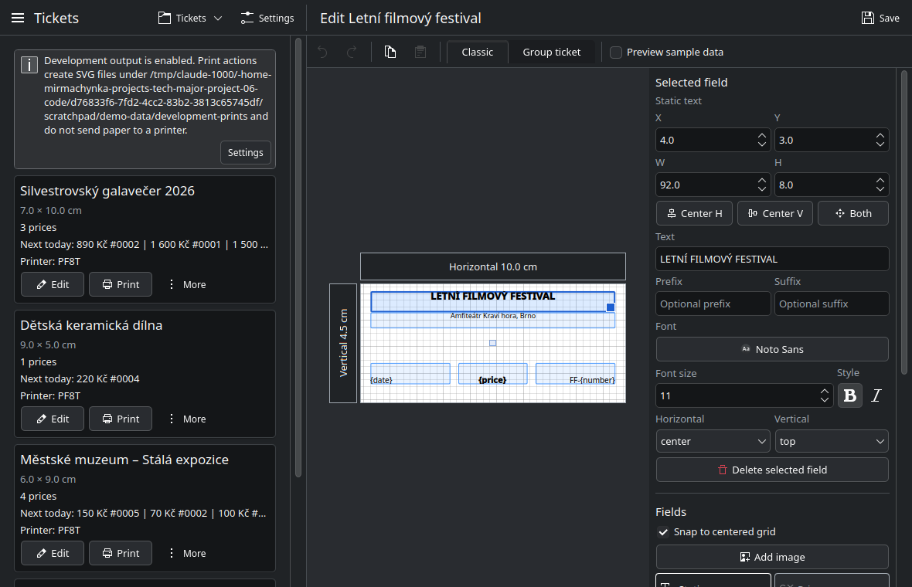
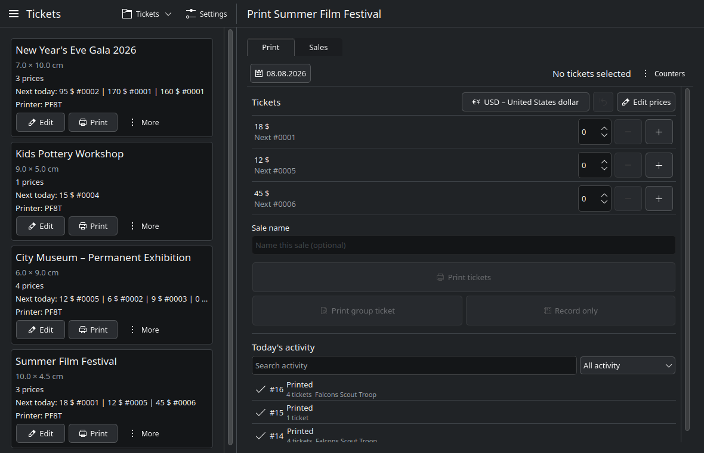
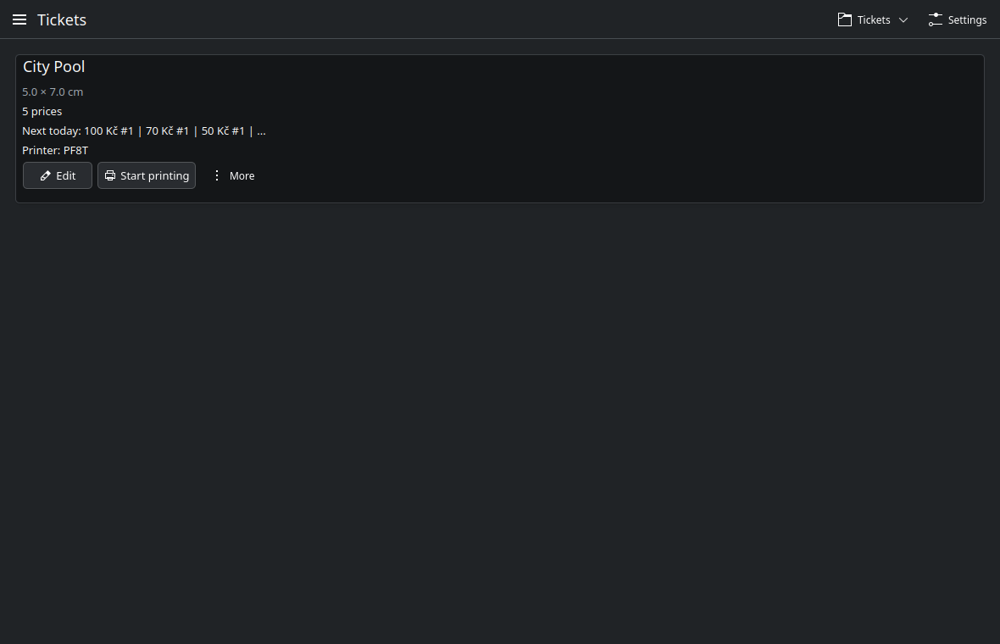

<div align="center">

<picture>
  <source media="(prefers-color-scheme: dark)" srcset="crates/ticket-kde/src/qml/assets/logo-dark.svg">
  
</picture>

**Design, sell, and print admission tickets from one desktop app; sequential numbering, group tickets, multi-currency pricing, and a full sales record included.**

[](LICENSE)
[](#install)
[](#install)
[](#contributing)

</div>

---

## Contents

- [Install](#install)
- [Quick Start](#quick-start)
- [Screens](#screens)
- [Concepts](#concepts)
- [Configuration](#configuration)
- [Runtime](#runtime)
- [Documentation](#documentation)
- [Contributing](#contributing)
- [What It Does Not Do](#what-it-does-not-do)

## Install

Runtime support: Linux with Qt 6 and KDE Frameworks 6 libraries. The application runs on both Plasma and GNOME.

| Package | For | Notes |
| --- | --- | --- |
| `.rpm` | Fedora and other RPM distributions | Pulls in Qt 6, Kirigami, the QQC2 desktop style, CUPS client tools, librsvg, poppler and polkit |
| `.deb` | Debian and Ubuntu | Same dependencies, resolved through apt |
| `.AppImage` | Everything else | Bundles Qt 6, Kirigami, the QQC2 desktop style, the Qt SVG plugins, and the Breeze and Adwaita icon themes. Needs no Qt or KDE packages installed. Mark it executable and run it |

Download the one you want from the releases page. Graphics drivers, fonts and CUPS always come from the host.

To build from source instead, install the toolchain first:

```sh
./scripts/install-dependencies.sh
```

The script detects Fedora, Debian/Ubuntu and Arch families. On GNOME the KDE libraries install as plain libraries and do not pull in a Plasma session.

## Quick Start

```sh
bun i
bun run dev
```

Create a ticket, place fields on it in the editor, add prices on the print page, then print or record a sale.

## Screens

<table>
  <tr>
    <td width="50%"></td>
    <td width="50%"></td>
  </tr>
  <tr>
    <td><b>Editor.</b> Place static text, images, prices, dates and ticket numbers on the paper size you set. Each ticket carries a classic and a group layout.</td>
    <td><b>Print.</b> Pick quantities per price, name the sale, then print individual tickets, print one group ticket, or record the sale without printing.</td>
  </tr>
  <tr>
    <td></td>
    <td></td>
  </tr>
  <tr>
    <td><b>Sales.</b> Every day grouped by month with ticket counts and totals, selectable for spreadsheet export.</td>
    <td><b>Tickets.</b> Every ticket with its size, prices, next numbers and printer.</td>
  </tr>
</table>

## Concepts

### Tickets and Fields

A ticket is a paper size plus a field layout. Fields are static text, images, or dynamic values the application fills at print time: the price, the date, the ticket number, and for group tickets the sale name and the item list. Each ticket carries two layouts: a classic single ticket and a group ticket.

### Prices and Counters

A ticket has one or more prices. Each price keeps its own counter that advances every time a ticket at that price is sold. Counters reset per day. Correcting a counter by hand is recorded as an adjustment, not a silent edit.

### Sales

A sale is one or more tickets sold together. A sale of two or more tickets can be printed as individual tickets or as a single group ticket listing them. Any sale can carry a name. A sale that is recorded but not printed still advances the counters and still appears in the sales record.

### Currency

Prices are stored in the main currency set in Settings. A sale can be made in another currency; the application converts it using exchange rates fetched online and cached for six hours, and prints the currency symbol on the ticket.

## Configuration

Settings holds the CUPS queue, the development output switch, the data directory and the main currency. Backups are their own item in the sidebar.

### Paths

| What | Where |
| --- | --- |
| Binary | `/usr/bin/admitpress` |
| Desktop entry | `/usr/share/applications` |
| Icon | `/usr/share/icons/hicolor/scalable/apps` |
| AppStream metadata | `/usr/share/metainfo` |
| Database, artwork, print jobs, exports, backups | `$XDG_DATA_HOME/admitpress`, by default `~/.local/share/admitpress` |
| Chosen data directory | `$XDG_CONFIG_HOME/admitpress/data-dir` |

`TICKET_APP_DATA_DIR` overrides both of the last two.

## Runtime

### Backups

Every three hours, and once at startup when the last copy is older than that, the application writes `backups/backup-YYYYMMDD-HHMMSS.tar.gz` into the data directory. Each archive holds a consistent snapshot of the database taken with `VACUUM INTO`, the ticket artwork, and a manifest. Rendered print jobs and previews are excluded because they regenerate.

Copies are thinned automatically:

| Age | Kept |
| --- | --- |
| Under a day | Every copy |
| One day to one week | Newest per day |
| One week to one month | Newest per week |
| Over a month | None |

Restore by extracting an archive over the data directory while the application is closed.

### Update Checks

Every three hours, and once at startup, the application reads the latest release tag from the configured repository. The sidebar shows the current version and a newer one when it exists, and a dialog opens once per newly detected version with the link to install it from. The check is display only. AdmitPress never downloads or installs an update, and a failed check is silent.

### Printing

With development output enabled, print actions write SVG and PDF files instead of reaching the printer. With it disabled, jobs go to the selected CUPS queue. Failed jobs are recorded and appear in the day's activity.

## Documentation

Full guides live in [`docs/`](docs/README.md).

| Using it | Building it |
| --- | --- |
| [Getting started](docs/using/start.md) | [Architecture](docs/development/architecture.md) |
| [Designing tickets](docs/using/tickets.md) | [Setup](docs/development/setup.md) |
| [Prices and counters](docs/using/prices.md) | [Commands](docs/development/commands.md) |
| [Selling](docs/using/selling.md) | [Recipes](docs/development/recipes.md) |
| [Sales and export](docs/using/sales.md) | [Packaging](docs/development/packaging.md) |
| [Currency](docs/using/currency.md) | [Releasing](docs/development/releasing.md) |
| [Printing](docs/using/printing.md) | [Pitfalls](docs/development/pitfalls.md) |
| [Backups](docs/using/backups.md) | |

## Contributing

The application is Rust and QML: a `ticket-core` crate holding the domain and storage, and a `ticket-kde` crate binding it to Qt 6 and Kirigami through cxx-qt. Bun runs the tooling, and Code Discipline gates every command. See [`CONTRIBUTING.md`](CONTRIBUTING.md) for the commands and the rules, [`docs/development/`](docs/development/architecture.md) for how the pieces fit, and [`CHANGELOG.md`](CHANGELOG.md) for what has changed.

## What It Does Not Do

AdmitPress does not:

- Update itself, download releases, or install anything
- Restore a backup from inside the application
- Manage printers, install drivers, or configure CUPS queues beyond enabling and accepting a queue
- Track stock, seats, seat maps, or reservations
- Validate, scan, or redeem printed tickets
- Sync between machines, or run a server or shared database
- Accept payments or connect to a payment terminal
- Store exchange rates it has never fetched, or convert currency while offline with no cached rate
