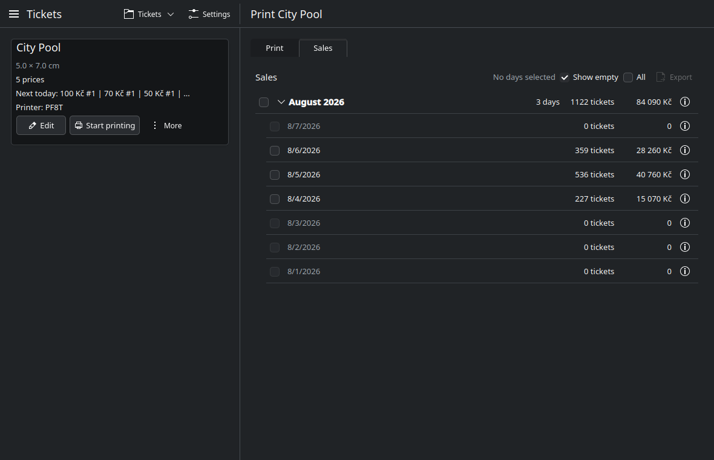

# Sales and Export

The **Sales** tab on the print page holds every recorded day.

## Reading the overview

Days are grouped by month. Each month row shows the number of days with sales,
the ticket count and the money total. The current month is expanded, earlier
months are collapsed. Click a month row to fold it.

Each day row shows its ticket count and total. Select one or more days and use
**More** > **Summary** to see the selected ticket count, money total and
per-price totals.

**Show empty** includes days with no sales, so a month reads as a calendar.
Turn it off to see only days that recorded something.

## Selecting days

Tick a day to select it. Ticking a month selects every day in it; the month
checkbox is partly filled when only some days are selected.

**All** selects every day that has recorded sales. It does not select empty
calendar days, so a month with three trading days selects three days, not
thirty one.

## Export

With days selected, press **Export** and choose a format:

| Format | Use |
| --- | --- |
| `.xlsx` | Excel and most spreadsheets |
| `.ods` | LibreOffice Calc |

The export contains a row per day and price, with quantities, unit prices and
totals. Files are written wherever you choose in the save dialog; the
application also keeps a copy under `exports/` in the data directory.

## Resetting a day

Select one day and use **More** > **Reset day** to clear that date's print
records and per-price counters. The action follows the same lock rule as
continuing in a day: a past day that already has sales cannot be reset.
